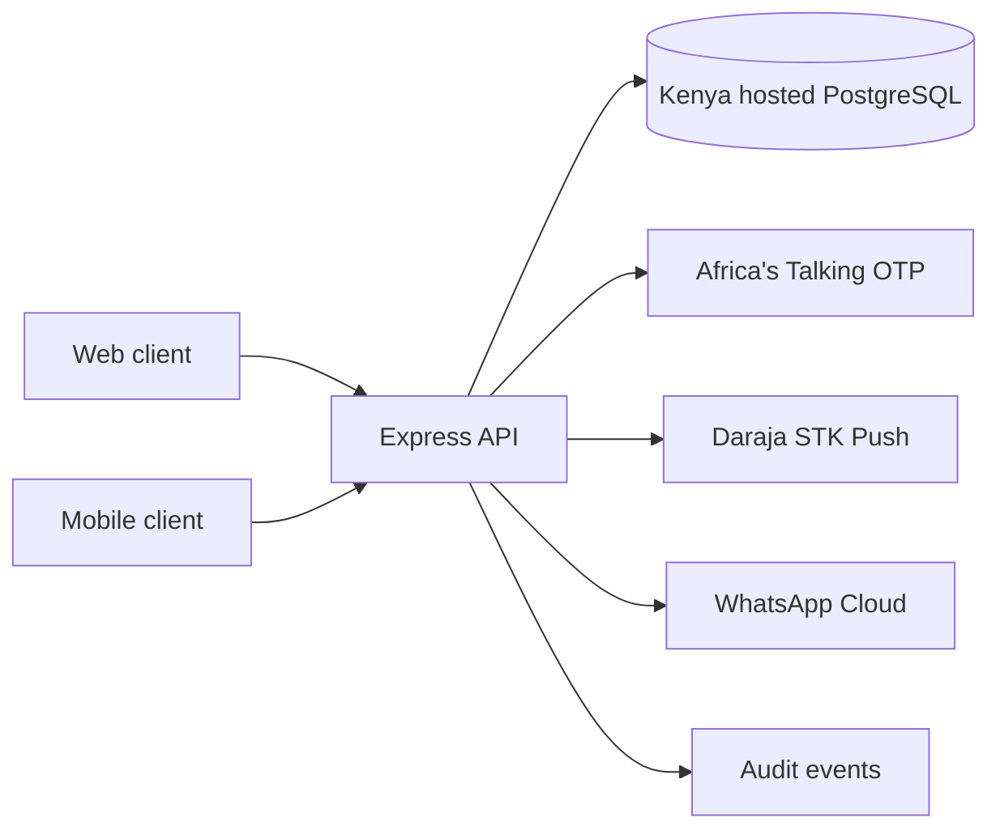

# Backend architecture and production path

The clients should call the API only through service modules. The API owns identity, authorization, patient records, queue status, visit transitions, prices, payment amount and analytics. Clients must never submit a trusted payment total or decide whether a visit transition is allowed.

## Domain decisions in this scaffold

- Patient phone numbers are normalized to E.164 Kenya format. A keyed HMAC is used for lookup; the phone and name are encrypted with AES-256-GCM at rest in the application schema.
- OTPs and session tokens are stored only as keyed hashes. Codes expire after five minutes, allow five attempts, and OTP requests are limited per number.
- Patient and staff roles are distinct. Staff roles are assigned through an operator-run CLI, not open registration.
- Visit state is stored centrally with guarded transitions; stage events provide an operational timeline. Lab orders are clinician-authored and patient-approved before lab work; results return to the doctor before prescriptions can be sent to pharmacy.
- Queue estimates use the current number ahead and a staff/service-time estimate. Use observed median service times and shift staffing after launch; avoid promising an exact wait.
- Money is stored as integer KES. The API computes payment amount from due charge lines inside the database; an idempotency key protects repeat STK requests.
- M-Pesa callbacks are reconciled with the Daraja STK query before a successful callback can close a visit. Payment integration still needs a Safaricom sandbox and approved live app to validate end to end.
- Support messages stay encrypted in PostgreSQL. Sending them to WhatsApp requires explicit patient consent. Webhook bodies are HMAC-verified.

## Recommended implementation sequence

1. Choose a Kenya data-center PostgreSQL provider and confirm backup/restore, encryption, private networking, incident response and contractual privacy terms.
2. Deploy API to a Kenya region, set TLS, secret manager, restricted ingress, rate limits, uptime/alerting, managed backups and a tested restore procedure.
3. Configure the provider sandbox accounts and webhook URLs; test OTP delivery, M-Pesa duplicate/timeout/failure callbacks, and WhatsApp consent/webhook flows with synthetic users.
4. The current web and mobile clients call the API through shared service modules. Mobile bearer tokens use the OS secure store; web bearer tokens are held for the browser session. Before public deployment, review web session handling and adopt an HttpOnly secure cookie or an equivalent reviewed session strategy.
5. Add clinician approval, audit review, privacy consent/retention and operational reconciliation for the facility. Validate each clinical transition with practitioners before any real records are entered.

The current code is a starting implementation. It does not replace a security review, clinical validation, a data-protection impact assessment, ODPC obligations, provider onboarding, backup drills, monitoring or production incident procedures.
